### Hi, I'm Luiz 👋

Full Stack Developer from Brazil. I build web applications end to end: **Angular** on the front end, **Node.js / NestJS** on the back end, with **PostgreSQL + Prisma** underneath.

- 🧩 Building a **multi-tenant ERP** (NestJS · Prisma · PostgreSQL · Angular), from database design to deployment
- ☁️ Day to day with Angular, GraphQL, Node.js and AWS Lambda
- ⚡ Took part in [Rinha de Backend 2026](https://github.com/luizlzag/rinha-de-backend-2026-luizlzag)
- 🛒 ~2 years building custom Shopify themes (Liquid, JavaScript, CSS)
- 💼 [LinkedIn](https://www.linkedin.com/in/luiz-sanches-715b45162/)

#### Stack

  
  
  
  
  
  
  
  
  
  
  
  
  
  
  
  
  
  
  

###

<picture>
  <source media="(prefers-color-scheme: dark)" srcset="https://raw.githubusercontent.com/luizlzag/luizlzag/output/pacman-contribution-graph-dark.svg">
  <source media="(prefers-color-scheme: light)" srcset="https://raw.githubusercontent.com/luizlzag/luizlzag/output/pacman-contribution-graph.svg">
  
</picture>
